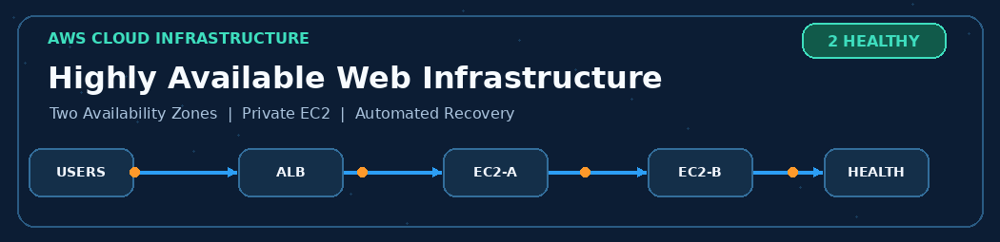
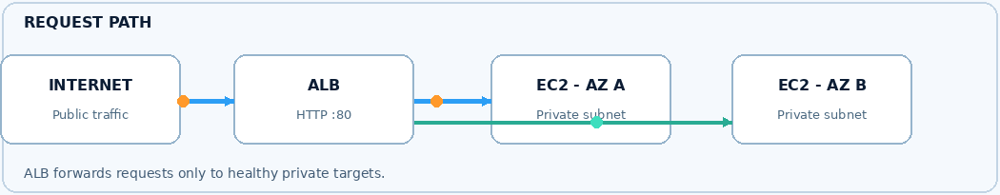

# Highly Available AWS Web Infrastructure



### Design and Implementation of a Highly Available AWS Web Infrastructure
**Business case study:** Meridian Retail Solutions (MRS) — *fictional medium-sized retail and distribution company*  
**Project type:** Personal, hands-on AWS infrastructure project  
**AWS Region:** Asia Pacific (Singapore), `ap-southeast-1`  
**Status:** Completed (short-duration proof of concept)

> This repository documents an independently implemented AWS infrastructure proof of concept. MRS is a fictional business scenario, not a real client engagement. The environment was designed for demonstration and testing, not as a production deployment.

## Overview

This project demonstrates how to host a simple Nginx website on **private Amazon EC2 instances** across **two Availability Zones** while exposing only an **internet-facing Application Load Balancer (ALB)** to web users. An **EC2 Auto Scaling Group** maintains two instances and can launch a replacement when an instance fails. **AWS Systems Manager Session Manager** provides administration without opening inbound SSH, while **Amazon CloudWatch** and **Amazon SNS** provide operational monitoring and email notifications.

The work focuses on **AWS cloud infrastructure, networking, security, high availability, and operational troubleshooting** rather than application development.

## Architecture




The architecture diagram is included in the [complete project documentation](docs/Final%20Documentation%20-%20Meridian%20Retail%20Solutions.pdf#page=11) (page 11).

**Application traffic:** `Internet users → Internet Gateway / public ALB → HTTP target group → private EC2 (Nginx)`  
**Administration:** `Authorized operator → AWS Systems Manager Session Manager → private EC2`  
**Private outbound traffic:** `Private EC2 → NAT Gateway (public subnet A) → Internet Gateway`

### Network design

| Component | Configuration |
|---|---|
| AWS Region | `ap-southeast-1` (Singapore) |
| VPC | `10.10.0.0/16` |
| Public subnet A | `10.10.10.0/24` |
| Public subnet B | `10.10.20.0/24` |
| Private subnet A | `10.10.30.0/24` |
| Private subnet B | `10.10.40.0/24` |
| Availability | Two Availability Zones |
| Application Load Balancer | Internet-facing, HTTP port 80 |
| Target group | Instance targets, HTTP port 80, health check `/`, success `200` |
| EC2 Auto Scaling | Minimum `2`, desired `2`, maximum `2` |
| EC2 launch template | Amazon Linux 2023, `t3.micro`, 8 GiB `gp3`, Nginx installed through user data |
| Public route | `0.0.0.0/0` → Internet Gateway |
| Private route | `0.0.0.0/0` → one NAT Gateway in public subnet A |

## AWS services and technologies

| Service / technology | Role in the project |
|---|---|
| Amazon VPC, subnets, route tables, Internet Gateway | Isolated networking and public/private traffic separation |
| NAT Gateway and Elastic IP | Outbound access for private instances |
| Amazon EC2 | Hosts the web servers and root volumes |
| Nginx and EC2 user data | Serves a sample website and automates first-boot setup |
| Application Load Balancer and target group | Routes HTTP requests to healthy instances |
| Amazon EC2 Auto Scaling and launch template | Maintains two instances and launches replacements |
| AWS IAM roles and security groups | Instance permissions and network access controls |
| AWS Systems Manager Session Manager | Managed access to private servers without inbound SSH |
| Amazon CloudWatch | Dashboards, infrastructure metrics, and unhealthy-target alarm |
| Amazon SNS | Confirmed email subscription for notifications |
| AWS Budgets | Cost alerts during the temporary deployment |

**Not in scope:** Amazon S3, Terraform, GitHub Actions, application databases, containers, or a custom application backend. These were **not** implemented as part of this project.

## Security controls

- Web servers were deployed in **private subnets without public IPv4 addresses**.
- The **ALB security group** permitted inbound HTTP (`TCP/80`) from the internet.
- The **EC2 security group** permitted inbound HTTP (`TCP/80`) **only from the ALB security group**.
- No inbound SSH (`TCP/22`) was opened on the web server security group.
- An EC2 IAM role with `AmazonSSMManagedInstanceCore` enabled Session Manager access.
- Public and private subnet route tables separated internet ingress from private-instance outbound access.

## Implementation summary

The full documentation contains screenshots and explanations of these stages:

1. Selected the Singapore Region and configured an AWS Budget alert.
2. Created the VPC and four public/private subnets across two AZs.
3. Attached the Internet Gateway and configured the public route table.
4. Created one NAT Gateway and configured the private route table.
5. Configured ALB and web server security groups.
6. Created an IAM role for Systems Manager access.
7. Created an EC2 launch template with Amazon Linux 2023, Nginx user data, and a root EBS volume.
8. Created the HTTP target group and internet-facing ALB.
9. Created an Auto Scaling Group with a desired capacity of two instances.
10. Verified website access, registered target health, and private-instance network isolation.
11. Verified Session Manager administration of private instances.
12. Configured SNS email notifications and a CloudWatch dashboard/alarm.
13. Tested Auto Scaling instance replacement by deliberately terminating an ASG-managed instance.

See the [full illustrated report (PDF)](docs/Final%20Documentation%20-%20Meridian%20Retail%20Solutions.pdf) for configuration evidence.

## Validation and testing

| Test | Evidence documented |
|---|---|
| ALB / web service access | Browser access via the ALB DNS address (report p. 24) |
| Target health | Two healthy targets shown in the target group (report p. 23) |
| Private EC2 placement | No public IPv4 addresses on web servers (report pp. 24–25) |
| Secure administration | Session Manager access and Nginx checks (report pp. 25–26) |
| Monitoring and alerting | Confirmed SNS subscription, CloudWatch alarm and dashboard (report pp. 27–28) |
| Automated instance replacement | An ASG-managed instance was terminated, with replacement activity and an Auto Scaling notification documented (report pp. 29–30) |

The report documents the **instance replacement** test. It does not provide a measured recovery time or a production availability SLA; these are not claimed here.

## Important proof-of-concept limitations

- **HTTP only:** The ALB listener used port 80. HTTPS, TLS certificates, and AWS Certificate Manager were not configured.
- **One NAT Gateway:** Both private subnets used a NAT Gateway in one AZ, creating an outbound connectivity dependency on that AZ.
- **Fixed capacity:** Auto Scaling maintained two instances (`min=desired=max=2`); dynamic traffic-driven scaling was not tested.
- **No production SLA or disaster recovery guarantee:** The demonstration focused on individual EC2 instance replacement.
- **Manual AWS Console deployment:** Infrastructure as Code and CI/CD pipelines were not part of this implementation.

### Potential production enhancements

HTTPS with ACM; per-AZ NAT Gateways or suitable VPC endpoints; demand-based scaling policies; centralized log retention; stronger outbound restrictions; and formal resilience and load tests.

## Project documentation

📄 **[Final Documentation — Meridian Retail Solutions (PDF)](docs/Final%20Documentation%20-%20Meridian%20Retail%20Solutions.pdf)**

The motion graphics illustrate the architecture conceptually; they are not live infrastructure metrics.

The 31-page report includes the business scenario, requirements, AWS architecture diagram, network configuration, console screenshots, health checks, monitoring setup, and instance replacement testing.

## Repository structure

```text
highly-available-aws-web-infrastructure/
├── README.md
├── assets/
│   ├── aws-infrastructure-banner.gif
│   └── request-flow.gif
└── docs/
    └── Final Documentation - Meridian Retail Solutions.pdf
```

## Author

**Chanmith Jayathilake**  
*Personal AWS Cloud Infrastructure Project — October 2026*

## Usage and attribution

This repository is shared for learning and professional portfolio review. The accompanying PDF contains a separate copyright notice and terms of use; please review those terms before copying or redistributing its content.
